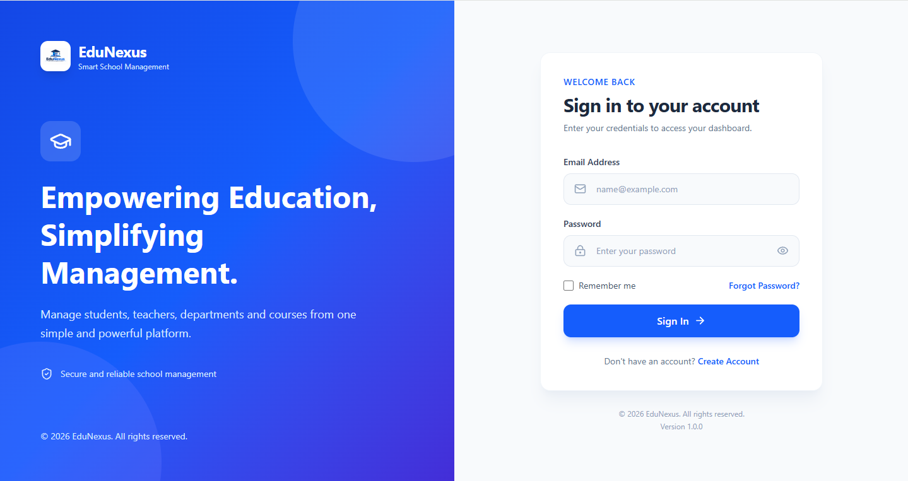
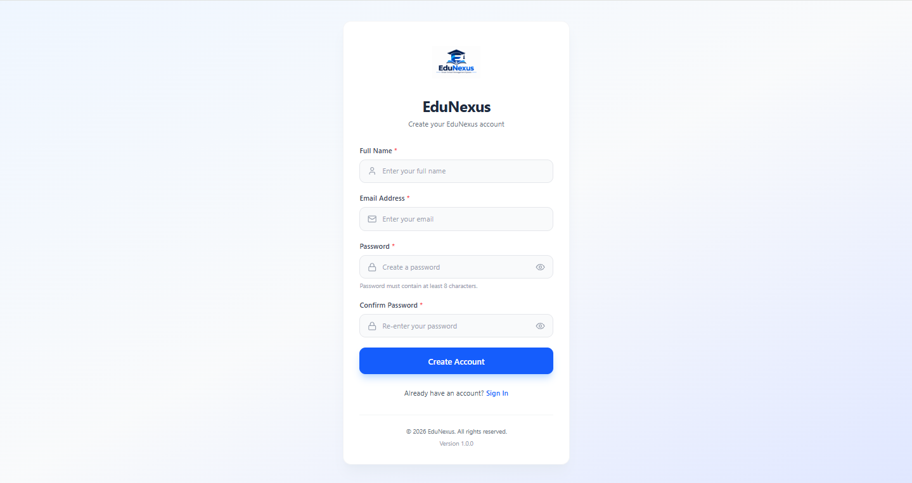
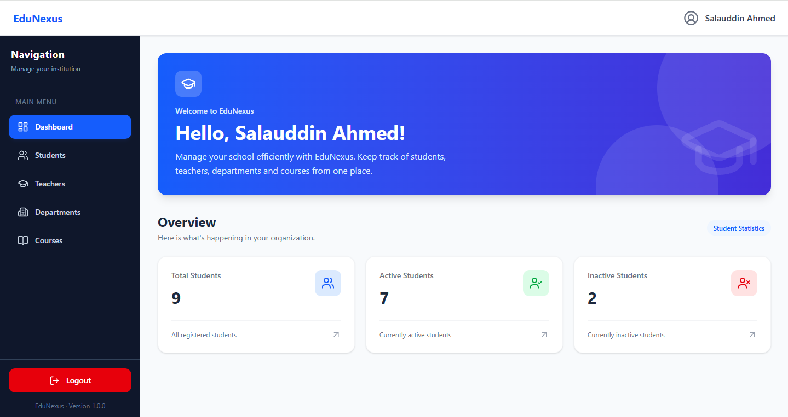
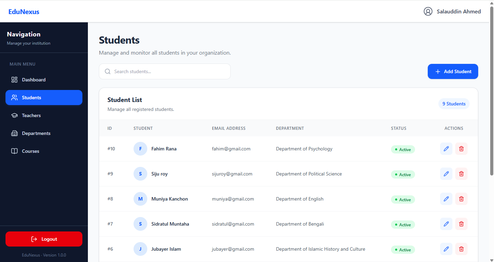
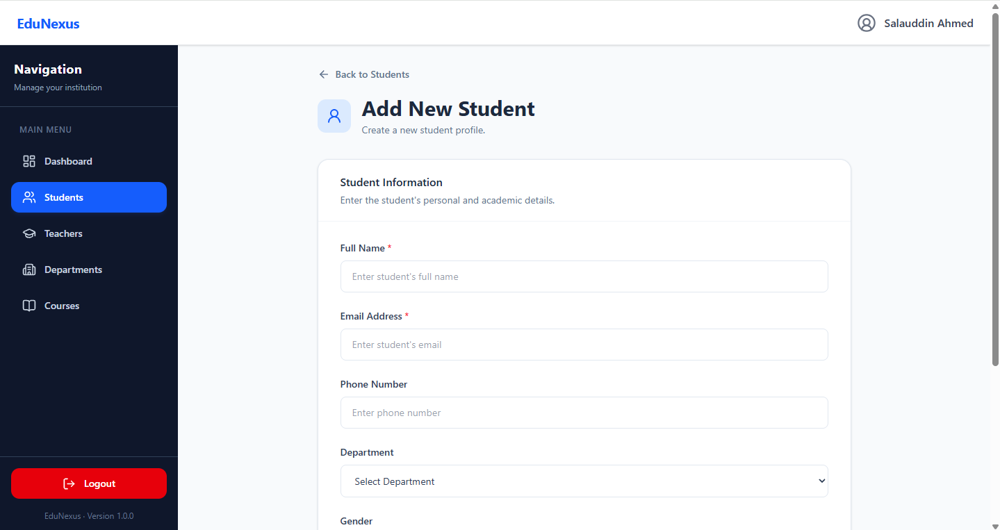
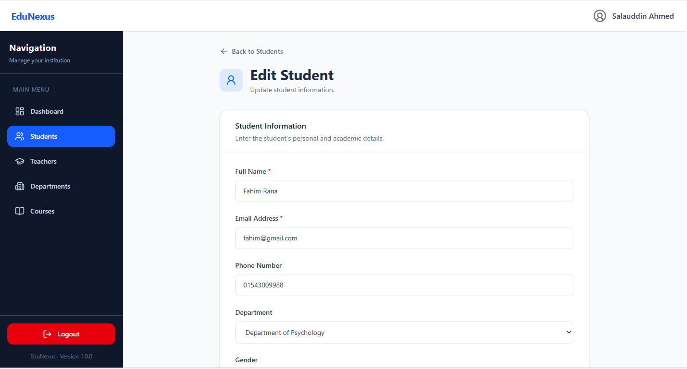
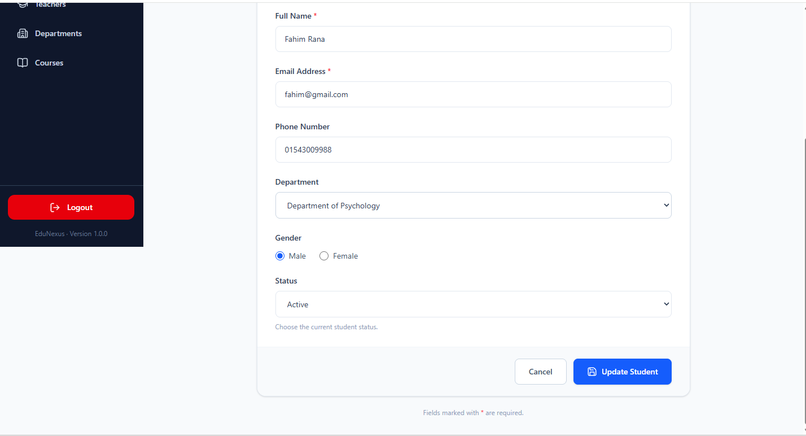
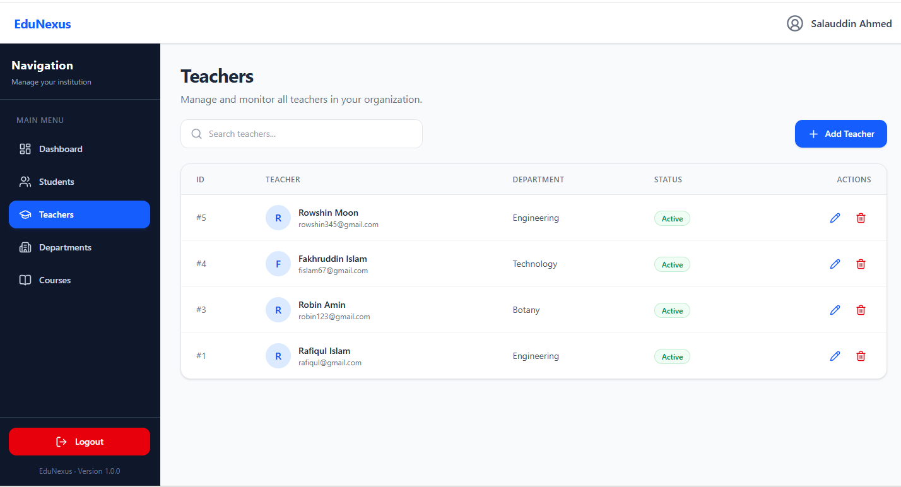
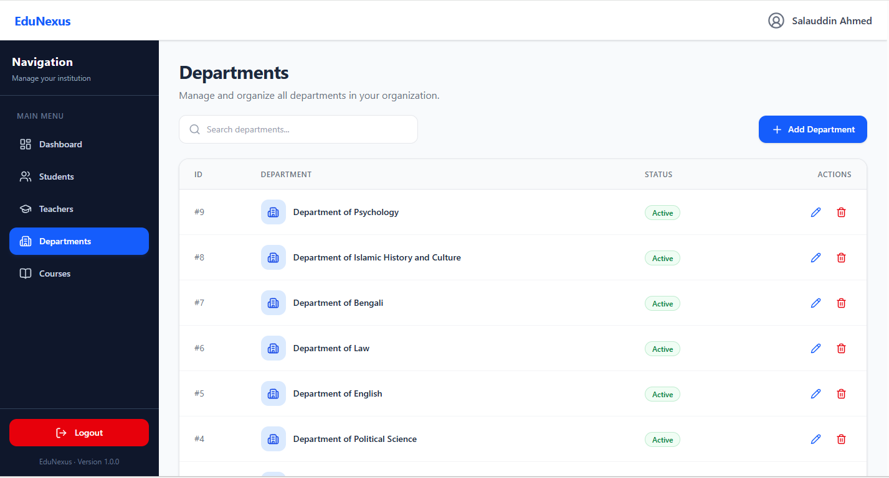
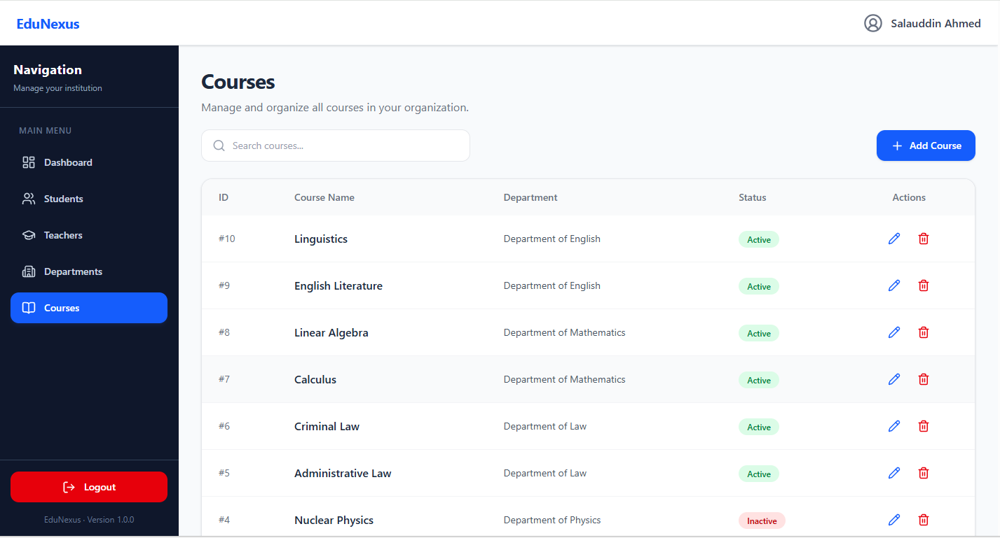

# EduNexus

> **Connecting Education, Simplifying Management.**

A modern **Full-Stack School Management System** built with **React, Laravel, MySQL, and Tailwind CSS**.

EduNexus is designed as a portfolio-quality project that demonstrates professional full-stack web development, clean architecture, RESTful API integration, responsive UI design, and real-world CRUD operations.

---

# 📖 Overview

EduNexus helps educational institutions manage their core academic resources through a clean, modern, and responsive web application.

The project focuses not only on building features but also on following professional software development practices including:

- Clean project architecture
- REST API development
- Git & GitHub workflow
- Documentation
- Version planning
- Feature-driven development
- Responsive UI/UX

---

# ✨ Features (Version 1.0.0)

## Authentication

- Secure Login
- User Registration
- Protected Routes
- Logout

## Student Management

- Create Student
- View Students
- Edit Student
- Delete Student
- Dynamic Department Selection

## Teacher Management

- Create Teacher
- View Teachers
- Edit Teacher
- Delete Teacher

## Department Management

- Create Department
- View Departments
- Edit Department
- Delete Department

## Course Management

- Create Course
- View Courses
- Edit Course
- Delete Course

## User Experience

- Responsive Layout
- Professional Dashboard
- Form Validation
- REST API Integration
- Clean Navigation
- Responsive Sidebar
- Mobile Friendly Interface

---

# 🚀 Tech Stack

## Frontend

- React (Vite)
- React Router
- Axios
- Tailwind CSS

## Backend

- Laravel 12
- RESTful API

## Database

- MySQL

## Version Control

- Git
- GitHub

---

# 📂 Project Structure

```text
EduNexus
│
├── client/                 # React Application
├── server/                 # Laravel REST API
├── docs/
│   ├── demo/
│   └── screenshots/
│
├── README.md
└── LICENSE
```

---

# 📸 Screenshots

| Page           | Preview                                  |
| -------------- | ---------------------------------------- |
| Login          |        |
| Register       |     |
| Dashboard      |    |
| Students       |     |
| Add Student    |   |
| Edit Student   |  |
| Student Update |  |
| Teachers       |     |
| Departments    |  |
| Courses        |      |

---

# 🎥 Demo

Project demonstration video:

**📹 EduNexus v1.0.0**

Location:

```text
docs/demo/EduNexus-v1.0.0.mp4
```

---

# ⚙️ Installation

## Clone Repository

```bash
git clone https://github.com/mbasar-8/EduNexus.git
```

## Frontend

```bash
cd client

npm install

npm run dev
```

## Backend

```bash
cd server

composer install

cp .env.example .env

php artisan key:generate
```

Configure your MySQL database inside the `.env` file.

Run database migrations:

```bash
php artisan migrate
```

Start Laravel server:

```bash
php artisan serve
```

---

# 📦 Version History

## ✅ Version 1.0.0

Completed Modules

- Authentication
- Student Management
- Teacher Management
- Department Management
- Course Management
- Responsive UI
- Responsive Sidebar
- REST API Integration
- Professional Dashboard
- Form Validation

Project Status

> ✅ Stable Release

---

# 🚀 Planned for Version 2

The following modules are planned for future development:

- Student Enrollment System
- Attendance Management
- Role & Permission Management
- Reports & Analytics
- Profile Management
- Notification System
- Dashboard Statistics
- Advanced Search & Filters
- Export (PDF / Excel)

---

# 👨‍💻 Developer

**Mominul Basar**

GitHub:

https://github.com/mbasar-8

Project Repository:

https://github.com/mbasar-8/EduNexus

---

# 📄 License

This project is released under the MIT License.
